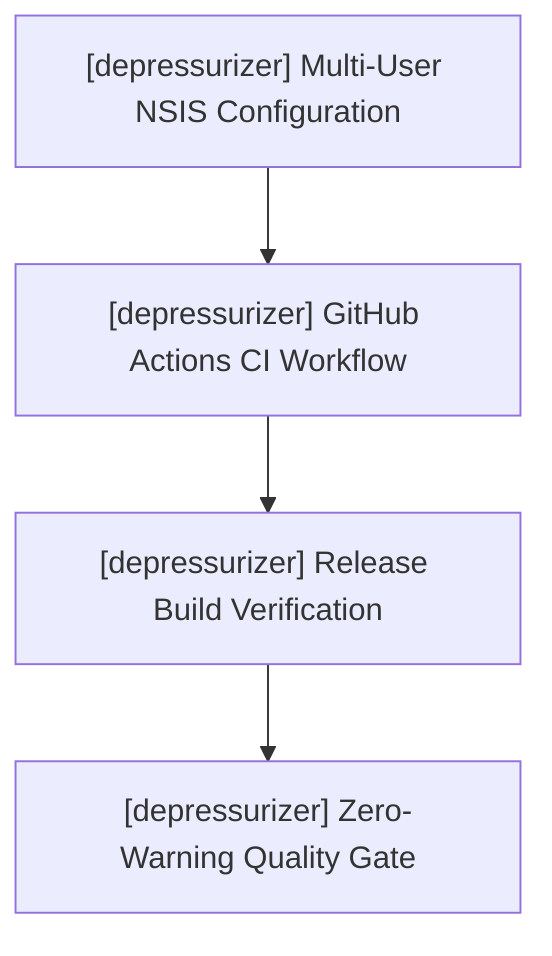

# depressurizer — Active Sprint Planning

> 🎯 **Living Source of Truth**: Active sprint roadmap, execution architecture, and completed sprint history for **depressurizer**.
> Pair with [`ROADMAP.md`](./ROADMAP.md) (direction), [`TODO.md`](./TODO.md) (task ledger), and [`BUGS.md`](./BUGS.md) (known issues).

---

## 📜 Tracking Rules

- **100% Active Direction Accuracy**: Reflect the current, active direction of Depressurizer with zero contradictions.
- **Active Sprints Only in Top Section**: `## 🎯 Active Sprints` contains only the currently active sprint. Completed sprints move immediately to `## ✅ Completed Sprints` (newest first).
- **Mandatory Quality Gate**: Compilers and typecheckers must pass with zero errors and zero warnings (`cargo test`, `svelte-check`).

---

## 🎯 Active Sprints

### 🚀 Sprint 5: [depressurizer] — Multi-Platform Packaging, CI & Release Gate (v0.8.0)
- **Project Identifier:** `[depressurizer]`
- **Repository Path:** `projects/depressurizer`
- **Target Objective:** Finalize cross-platform installation packages (Windows NSIS multi-user, macOS DMG, Linux AppImage/deb), establish clean GitHub Actions CI workflow, and validate the zero-warning quality gate across all targets.

#### 📝 Execution Tasks

1. **[depressurizer] Multi-Platform Packaging Configuration**:
   - `[depressurizer]` Verify NSIS multi-user installer script supporting all-users (`Program Files`) vs current-user (`AppData\Local\Programs`), desktop shortcut options, clean uninstall hooks, and process mutex checks.
   - `[depressurizer]` Configure macOS DMG window layout and bundle identifiers.
   - `[depressurizer]` Configure Linux AppImage / deb desktop entry file and category metadata.
2. **[depressurizer] Continuous Integration Workflow**:
   - `[depressurizer]` Implement modern `.github/workflows/ci.yml` matrix building on Windows, macOS, and Linux runners.
   - `[depressurizer]` Enforce `cargo test`, `cargo check`, and `svelte-check` with zero warnings in CI.
3. **[depressurizer] Final Quality Gate & Release Readiness**:
   - `[depressurizer]` Validate runtime offline startup from SQLite without network connection.
   - `[depressurizer]` Verify dev/test `.env` fallback functions as intended without leaking credentials into builds.

---

## ✅ Completed Sprints

### 🚀 Sprint 4: [depressurizer] — Bottom Action Dock Dropdown, Multiselect & UI Refinements (v0.8.0-rc.1)
- **Delivered (2026-10-18):**
  - Replaced popover with native `<select id="autocat-filter-select">` dropdown in the bottom dock listing all prebuilt filters (HowLongToBeat, Genres, Tags, Years, Scores, VR, Dev/Pub, Platforms) and custom rules.
  - Linked `Apply AutoCat` button directly to filter selection with optional `Only selected` scoping.
  - Added dedicated `⚙️ AutoCat Studio…` button opening the rule creation/management modal.
  - Verified table multiselect with batch category assign/clear, favorite toggle, and hidden toggle.
  - Extracted SCSS styling partials and verified zero errors and zero warnings across `svelte-check` and `cargo test`.

### 🚀 Sprint 3: [depressurizer] — AutoCat Studio, Dynamic Categorization & Regex Engine (v0.8.0-beta.2)
- **Delivered (2026-10-18):**
  - Integrated `regex = "1"` crate into Rust backend.
  - Added `AutoCatFilterType::Regex` supporting regular expressions with capture group auto-naming (`^([A-Z])` → alphabetical category).
  - Implemented dynamic target category derivation (`⚡ Dynamic (Auto)`), eliminating mandatory manual category names.
  - Built collapsible in-app explanatory guide card in AutoCat Studio (`📘 How Custom Filters & Dynamic AutoCat Work`).
  - Implemented one-click `⚡ Auto-Provision Standard Suite` for prebuilt rules (Genres, Tags, Years, Scores, VR, HLTB, Platforms).
  - Restored dev/test `.env` loading (`STEAM_API_KEY`, `STEAMID64`, `STEAM_PATH`) in `models.rs` and `storage.rs`.

### 🚀 Sprint 2: [depressurizer] — Official Steam Web API Engine & SQLite Storage (v0.8.0-beta.1)
- **Delivered (2026-10-18):**
  - Built official Steam Web API client (`GetOwnedGames/v1`) fetching entire user library with pagination and app metadata.
  - Implemented native SQLite (`rusqlite`) database storage (`depressurizer.db`) with WAL mode for settings and library cache.
  - Abandoned and removed legacy local VDF parsing and direct Steam client process inspection.
  - Preserved archived C# WinForms codebase in `legacy/` as an intentional historical reference.
  - Implemented HowLongToBeat (HLTB) playtime enrichment (main story, main+extras, completionist).

### 🚀 Sprint 1: [depressurizer] — Tauri v2 Core Scaffolding & Design System (v0.8.0-alpha)
- **Delivered (2026-10-18):**
  - Scaffolded Tauri v2 architecture with Rust backend, Svelte 5 frontend, TypeScript, and Vite.
  - Integrated obsidian dark SCSS design system tokens (`#07111f`, `#0d1b2d`, `#48d8f2`, `#b06cff`).
  - Generated cross-platform icon suites (ICNS, ICO, PNG) and NSIS setup artwork.
  - Established initial community-health documents and GPL-3.0 licensing.
