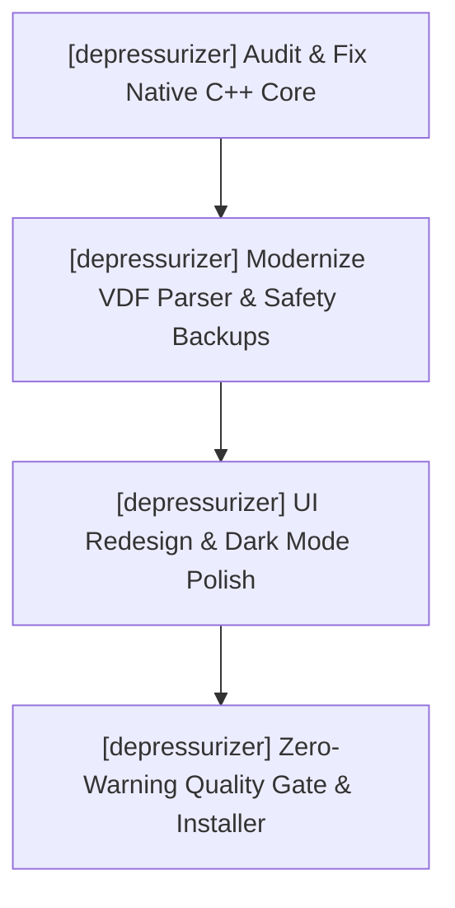

# depressurizer — Active Sprint Planning

> 🎯 **Living Source of Truth**: Active sprint roadmap, execution architecture, and completed sprint history for **depressurizer**.
> Pair with [`ROADMAP.md`](./ROADMAP.md) (direction), [`TODO.md`](./TODO.md) (task ledger), and [`BUGS.md`](./BUGS.md) (known issues).

---

## 📜 Tracking Rules

- **100% Active Direction Accuracy**: Reflect the current, active direction of Depressurizer with zero contradictions.
- **Active Sprints Only in Top Section**: `## 🎯 Active Sprints` contains only the currently active sprint. Completed sprints move immediately to `## ✅ Completed Sprints` (newest first).
- **Mandatory Quality Gate**: Compilers and static analysis must pass with zero errors and zero warnings (`MSVC /W4 /WX`).

---

## 🎯 Active Sprints

### 🚀 Sprint 5: [depressurizer] — Native Windows C++ Modernization & UI Polish (v1.0.0, W.05)
- **Project Identifier:** `[depressurizer]`
- **Repository Path:** `projects/depressurizer`
- **Target Objective:** Abandon the Tauri v2 rewrite entirely. Focus on auditing, fixing, and modernizing the native C++ Windows application, eliminating legacy bugs, and polishing the UI design to replace visual ugliness with a modern Windows 11 interface.
- **Licensing Invariant:** Strict GPL-3.0 compliance preserved across all native source code.

#### 📝 Execution Tasks

1. **[depressurizer] Audit & Fix Native C++ Core**:
   - `[depressurizer]` Audit the native codebase; fix compilation warnings, memory leaks, and legacy Win32 API issues under MSVC C++20.
   - `[depressurizer]` Verify AutoCat rule evaluation algorithms against large Steam libraries.
2. **[depressurizer] VDF Parser & Steam Integration Hardening**:
   - `[depressurizer]` Modernize Valve Data Format (VDF) reader/writer to safely handle current Steam client formats.
   - `[depressurizer]` Ensure mandatory timestamped backup generation before any file writes to `sharedconfig.vdf`.
3. **[depressurizer] Native UI Redesign & Polish**:
   - `[depressurizer]` Eliminate clunky and ugly legacy UI elements across dialogs, forms, and tables.
   - `[depressurizer]` Implement modern Windows 11 Fluent design principles (dark mode support, clean typography, refined margins).
   - `[depressurizer]` Improve category workbench and rule configuration panels for intuitive batch operations.
4. **[depressurizer] Quality Gate & Packaging**:
   - `[depressurizer]` Enforce MSVC `/W4 /WX` (zero warnings treated as errors).
   - `[depressurizer]` Author native Windows installer (NSIS/MSI) and release script.

---

## ✅ Completed Sprints

### 🚀 Sprint 4: [depressurizer] — Exploratory AutoCat Prototyping (v0.8.0-rc.1)
- **Delivered (2026-10-18):**
  - Prototyped filter selection logic and AutoCat rule structures.
