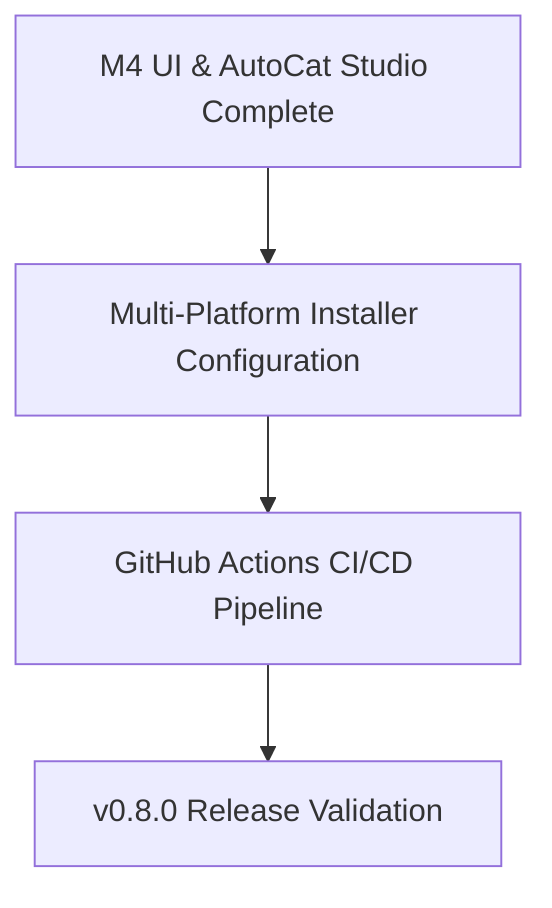

# depressurizer — Roadmap & Milestones

> 🗺️ **Living Source of Truth**: Product direction, positioning principles, and milestone delivery history for **depressurizer**.
> Pair with [`PLAN.md`](./PLAN.md) (sprint execution), [`TODO.md`](./TODO.md) (task ledger), and [`BUGS.md`](./BUGS.md) (issues and quirks).

---

## 📜 Tracking Rules

- **100% Active Direction Accuracy**: `ROADMAP.md`, `PLAN.md`, `TODO.md`, and `BUGS.md` must reflect the current, active direction of Depressurizer with zero contradictions.
- **Self-Contained Repository Memory**: This repository tracks its own product roadmap and development sprints independently.
- **Copyleft License Preservation**: As an upstream revival fork, strictly licensed under **GPL-3.0**.
- **Explicit Project Tagging**: All milestones, sprints, and tasks are tagged with `[depressurizer]`.

---

## 🔭 Vision & Positioning Principles

1. **Core Value Proposition**: Cross-platform desktop categorization manager for Steam libraries, reviving Depressurizer with a modern, high-performance Tauri v2 (Rust + Svelte 5 + SCSS) stack, SQLite persistence, and intelligent AutoCat rules.
2. **Design Principles**:
   - **Key-Only Official API Architecture**: Rely primarily on the official Steam Web API and Store API for library retrieval and metadata enrichment, eliminating fragile, Windows-only local VDF parsing.
   - **Performance First**: Native Rust core with Tokio asynchronous task streaming and SQLite (`rusqlite`) storage with WAL mode for instant startup and zero UI stutter across tens of thousands of titles.
   - **Intelligent AutoCat Engine**: Configurable, deterministic rules (genres, tags, developers, release years, review scores, VR support, HowLongToBeat playtimes, and regex capture groups) with dynamic category auto-naming.
   - **Clean Obsidian Dark UI**: Polished, accessible dark interface built with modular SCSS, zero-warning Svelte 5 runes, and keyboard-friendly batch workbench operations.
3. **Non-Goals & Boundaries**:
   - No runtime dependency on running desktop Steam client processes.
   - No hardcoded secrets, personal Steam IDs, or credentials committed to source control.

---

## 🗺️ Milestone Overview

| # | Milestone | Scope | Status | Version / Target | Focus |
|---|---|---|---|---|---|
| **M1** | [depressurizer] Foundation & Tauri v2 Scaffolding | Desktop core | ✅ Shipped | `v0.8.0-alpha` | Tauri v2 scaffold, Rust backend, Svelte/SCSS frontend, obsidian dark theme |
| **M2** | [depressurizer] Steam Web API & SQLite Engine | Library engine | ✅ Shipped | `v0.8.0-beta.1` | Web API GetOwnedGames, Store API enrichment, SQLite database persistence |
| **M3** | [depressurizer] AutoCat Studio & Dynamic Filters | Categorization | ✅ Shipped | `v0.8.0-beta.2` | AutoCat rules engine, dynamic category derivation, regex capture groups, HLTB filter |
| **M4** | [depressurizer] UI Refinement & Workbench Dock | Interface | ✅ Shipped | `v0.8.0-rc.1` | Bottom action dock dropdown, table multiselect, batch actions, accessible modals |
| **M5** | [depressurizer] Multi-Platform Packaging & Release | Packaging | 🚀 Active | `v0.8.0` | NSIS multi-user Windows installer, macOS DMG, Linux AppImage, GitHub CI |
| **M6** | [depressurizer] Cloud Collection Synchronization | Cloud Sync | ⏳ Planned | `v0.9.0` | Cloud collection export/sync exploration, Steam cloudstorage investigation |

---

## 🚀 Active Milestones

### [depressurizer] — Milestone M5: Multi-Platform Packaging & Release (v0.8.0)

#### Detailed Deliverables

- 🎯 **[depressurizer] Installer & Distribution Packaging**:
  - Windows: Multi-user NSIS installer supporting all-users and current-user installations, desktop shortcuts, uninstaller hooks.
  - macOS: Universal DMG bundle signed for desktop execution.
  - Linux: Self-contained AppImage and Debian package (`.deb`).
- 🎯 **[depressurizer] GitHub Actions Workflow**:
  - Automated build and test pipeline for Rust (`cargo test`, `cargo check`) and frontend (`svelte-check`, `vite build`).
  - Automated release artifact generation on SemVer git tags.

---

## 📌 Historical Milestones & Shipped Releases

### [depressurizer] — Milestone M1–M4: Desktop Core, Web API, AutoCat Studio & Workbench (v0.8.0-rc.1)
- Scaffolded Tauri v2 architecture with Rust backend and Svelte/SCSS frontend.
- Migrated legacy monolithic C# code into `legacy/` reference folder.
- Built native SQLite database (`depressurizer.db`) storage with WAL mode.
- Built official Steam Web API client (`GetOwnedGames`) fetching complete library.
- Built AutoCat Studio with prebuilt filters (Genres, Tags, Years, Scores, VR, Platforms, HLTB, Dev/Pub) and custom rules.
- Implemented dynamic target category derivation and Regex capture group extraction.
- Built main view bottom action dock with native filter dropdown and `Apply AutoCat` button.
- Shipped full community-health documents (`CONTRIBUTING.md`, `CODE_OF_CONDUCT.md`, `SECURITY.md`, etc.).
- Verified zero errors and zero warnings across Rust (`cargo test`) and frontend (`svelte-check`).
