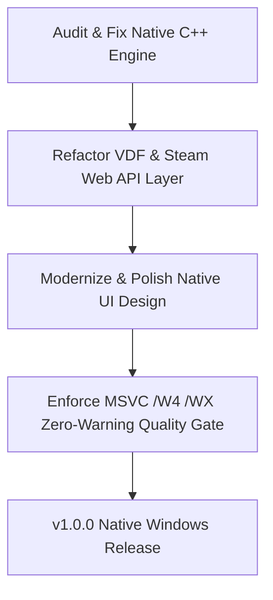

# depressurizer — Roadmap & Milestones

> 🗺️ **Living Source of Truth**: Product direction, positioning principles, and milestone delivery history for **depressurizer**.
> Pair with [`PLAN.md`](./PLAN.md) (sprint execution), [`TODO.md`](./TODO.md) (task ledger), and [`BUGS.md`](./BUGS.md) (issues and quirks).

---

## 📜 Tracking Rules

- **100% Active Direction Accuracy**: `ROADMAP.md`, `PLAN.md`, `TODO.md`, and `BUGS.md` reflect the current, active direction of Depressurizer with zero contradictions.
- **Self-Contained Repository Memory**: This repository tracks its own product roadmap and development sprints independently.
- **Copyleft License Preservation**: As an upstream revival fork, strictly licensed under **GPL-3.0**.
- **Explicit Project Tagging**: All milestones, sprints, and tasks are tagged with `[depressurizer]`.

---

## 🔭 Vision & Positioning Principles

1. **Core Value Proposition**: Native Windows Steam library categorizer and AutoCat manager (revival fork). The experimental Tauri v2 rewrite is abandoned; focus is centered on maintaining, fixing, and modernizing the native Windows desktop application with pure native C++ and a polished, contemporary Windows UI.
2. **Design Principles**:
   - **Pure Native Windows Application**: Pure native Windows execution. No Tauri, no webviews, no cross-platform POSIX overhead.
   - **Modernized Native UI**: Eliminate the visual clunkiness and ugliness of the legacy interface. Implement clean typography, dark theme support, modern iconography, and intuitive layout proportions.
   - **Robust AutoCat Engine**: Configurable, deterministic rules (genres, tags, developers, release years, review scores, and regex groups) with dynamic category generation.
   - **Safe Steam VDF Handling**: Valve Data Format (VDF) reader/writer with mandatory timestamped backups prior to any writes.
3. **Non-Goals & Boundaries**:
   - No cross-platform support (Windows-only native desktop execution).
   - No hardcoded personal Steam IDs or account passwords.

---

## 🗺️ Milestone Overview

| # | Milestone | Scope | Status | Version / Target | Focus |
|---|---|---|---|---|---|
| **M1–M4** | [depressurizer] Exploration & Scaffolding | Desktop core | ✅ Shipped | `v0.8.0-alpha` | AutoCat rules engine, VDF parser prototypes, UI explorations |
| **M5** | [depressurizer] Native Windows C++ Modernization & UI Polish | Native Windows | 🚀 Active | `v1.0.0` | Abandon Tauri rewrite; modernize native C++ core, fix bugs, polish UI styling |
| **M6** | [depressurizer] Advanced AutoCat Rules & Steam Cloud Sync | Advanced rules | ⏳ Planned | `v1.1.0` | Expanded rule templates, custom tag scrapers, automated backup sync |

---

## 🚀 Active Milestones

### [depressurizer] — Milestone M5: Native Windows C++ Modernization & UI Polish (v1.0.0)

> **Strategic Directive:** Abandon the Tauri v2 rewrite entirely. Focus 100% on fixing the existing native C++ application, eliminating bugs, and polishing the UI design to replace legacy clunkiness with a modern Windows experience.

#### Detailed Deliverables

- 🎯 **[depressurizer] Engine Fixes & Modernization**:
  - Audit existing native C++ codebase, resolve runtime bugs, and modernize to C++20 standard.
  - Enhance Steam library detection and non-blocking VDF parser with automated safety backups.
- 🎯 **[depressurizer] Native UI Polish**:
  - Redesign legacy dialogs and panels, eliminating visual clunkiness.
  - Introduce modern Windows 11 styling (dark mode support, refined borders, DPI-aware layouts).
  - Streamline category management workbench and rule editor panels.
- 🎯 **[depressurizer] Quality Gate & Packaging**:
  - MSVC compilation with `/W4 /WX` (zero warnings treated as errors).
  - Native Windows installer packaging (MSI / NSIS) and GitHub Release automation.

---

## 📌 Historical Milestones & Shipped Releases

### [depressurizer] — Milestones M1–M4
- Explored AutoCat rules engine logic, Steam Web API integrations, and category derivation trees.
