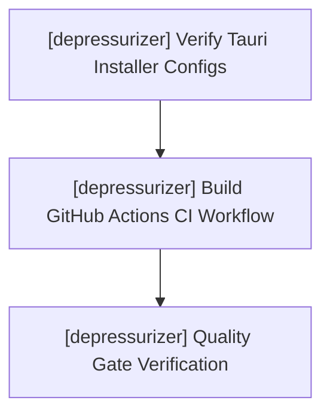

# depressurizer — Task Checklist & Workstream Tracking

> 📋 **Living Source of Truth**: Actionable task ledger for **depressurizer**.
> Statuses: ⬜ backlog · 🚧 in progress · ✅ done (tracked as `- [ ]` and `- [x]` checkboxes).
> High-level direction lives in [`ROADMAP.md`](./ROADMAP.md), active sprints in [`PLAN.md`](./PLAN.md), issues in [`BUGS.md`](./BUGS.md).

---

## 📜 Tracking Rules

- **100% Active Direction Accuracy**: Task items and checklists must reflect the current state of Depressurizer with zero contradictions.
- **Normalized Directives**: Rewrite user directives into clean, self-contained engineering requirements.
- **Done Moves Down**: Completed items are marked with `- [x]` and archived when workstreams finish.
- **Zero-Warning Gate**: All builds and tests must pass with 0 errors and 0 warnings (`cargo test`, `svelte-check`).

---

## 🔥 Active Workstreams

### 🎯 [depressurizer] Workstream W.05: Multi-Platform Packaging & GitHub CI Pipeline
- **Project Identifier:** `[depressurizer]`
- **Repository Path:** `projects/depressurizer`
- **Target Component:** Packaging & CI/CD

**Implementation checklist:**
- [ ] **[depressurizer] 1. Multi-Platform Installer Configuration**:
  - [ ] `[depressurizer]` NSIS Windows installer verification (all-users vs per-user installation paths, desktop shortcut checkbox, clean uninstaller registry hooks).
  - [ ] `[depressurizer]` macOS bundle verification (DMG volume name, icon layout, application symlink).
  - [ ] `[depressurizer]` Linux AppImage & Debian package metadata verification (`.desktop` categories and icons).
- [ ] **[depressurizer] 2. GitHub Actions CI Pipeline**:
  - [ ] `[depressurizer]` Create `.github/workflows/ci.yml` matrix building on `windows-latest`, `macos-latest`, `ubuntu-latest`.
  - [ ] `[depressurizer]` Enforce `cargo test`, `cargo check`, and `svelte-check` with zero warnings in CI.
  - [ ] `[depressurizer]` Automate release bundle generation on SemVer tag push.
- [ ] **[depressurizer] 3. Quality Gate & Zero-Warning Verification**:
  - [ ] `[depressurizer]` `cargo test` passing all backend test cases (dynamic categories, regex filter, HLTB playtime range, genre matching).
  - [ ] `[depressurizer]` `npm run check` reporting 0 errors and 0 warnings.
  - [ ] `[depressurizer]` Offline launch check from SQLite database cache.

---

## ✅ Completed Workstreams

### 🎯 [depressurizer] Workstream W.04: Workbench Dock Dropdown, Multiselect & UI Refinements
- **Delivered (2026-10-18):**
  - [x] `[depressurizer]` Main library view bottom action dock with native filter `<select id="autocat-filter-select">` dropdown.
  - [x] `[depressurizer]` Prebuilt filters populated: HowLongToBeat, Genres, Tags, Years, Scores, VR, Dev/Pub, Platforms, and All Configured Rules.
  - [x] `[depressurizer]` `Apply AutoCat` button executing selected filter directly without text inputs.
  - [x] `[depressurizer]` Dynamic `Only selected ({count})` checkbox scoping categorization to selected games.
  - [x] `[depressurizer]` Dedicated `⚙️ AutoCat Studio…` button opening rule management dialog.
  - [x] `[depressurizer]` Workbench table multiselect with batch category assign/clear, favorite toggle, and hidden toggle.
  - [x] `[depressurizer]` Svelte accessibility compliance (`role="dialog"`, `aria-modal="true"`, keyboard dismissals).

### 🎯 [depressurizer] Workstream W.03: AutoCat Studio, Dynamic Categorization & Regex Engine
- **Delivered (2026-10-18):**
  - [x] `[depressurizer]` Added `AutoCatFilterType::Regex` supporting regular expressions with capture group auto-naming (`^([A-Z])` → A-Z folders).
  - [x] `[depressurizer]` Dynamic target category derivation (`⚡ Dynamic (Auto)`), eliminating mandatory manual category names.
  - [x] `[depressurizer]` Collapsible in-app explanatory guide card in AutoCat Studio (`📘 How Custom Filters & Dynamic AutoCat Work`).
  - [x] `[depressurizer]` One-click `⚡ Auto-Provision Standard Suite` for prebuilt rules.
  - [x] `[depressurizer]` Restored local `.env` loading (`STEAM_API_KEY`, `STEAMID64`, `STEAM_PATH`) in `models.rs` and `storage.rs` for testing/development.
  - [x] `[depressurizer]` Backend unit tests added: `test_autocat_dynamic_categories_and_prefix` and `test_autocat_regex_filter`.

### 🎯 [depressurizer] Workstream W.02: Official Steam Web API Engine & SQLite Storage
- **Delivered (2026-10-18):**
  - [x] `[depressurizer]` Official Steam Web API client (`IPlayerService/GetOwnedGames/v1`) fetching all owned games.
  - [x] `[depressurizer]` Official Store API tag/genre lookup with rate-limiting and cache.
  - [x] `[depressurizer]` HowLongToBeat (HLTB) playtime enrichment (main story, main+extras, completionist) and AutoCat filter integration.
  - [x] `[depressurizer]` Native SQLite (`rusqlite`) database storage (`depressurizer.db`) in WAL mode for lightning-fast loads and offline support.
  - [x] `[depressurizer]` Tokio background workers streaming real-time progress events to prevent UI hangs.
  - [x] `[depressurizer]` Legacy C# WinForms codebase preserved in `legacy/` as an intentional historical reference; local VDF parsing removed.

### 🎯 [depressurizer] Workstream W.01: Tauri v2 Core Scaffolding & Community Health
- **Delivered (2026-10-18):**
  - [x] `[depressurizer]` Scaffolded Tauri v2 architecture (Rust backend + Svelte 5 frontend + TypeScript + Vite).
  - [x] `[depressurizer]` Modular SCSS design system with obsidian dark theme tokens (`#07111f`, `#0d1b2d`, `#48d8f2`, `#b06cff`).
  - [x] `[depressurizer]` Full community-health documents shipped (`CONTRIBUTING.md`, `CODE_OF_CONDUCT.md`, `SECURITY.md`, `SUPPORT.md`, `PRIVACY.md`, `CHANGELOG.md`, `GOVERNANCE.md`, `CITATION.cff`, `TOS.md`, PR template, issue forms).
  - [x] `[depressurizer]` GPL-3.0 license preserved per copyleft revival fork invariant.
